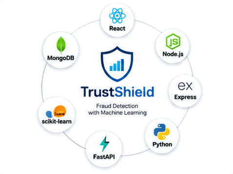
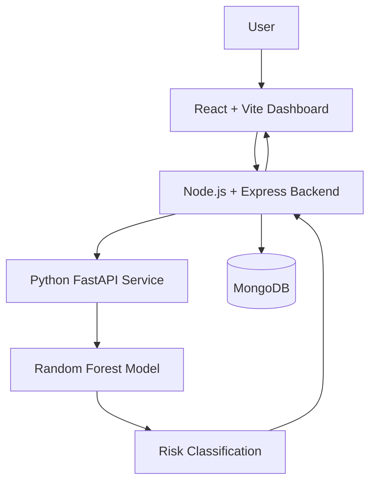
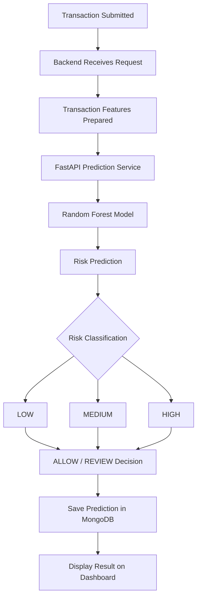

   <h1>🛡️ TrustShield</h1>
Explainable Financial Transaction Fraud Detection

**Intelligent transaction monitoring powered by machine learning.**

TrustShield is a full-stack financial transaction fraud detection application that combines machine learning with transaction risk analysis. It uses a Random Forest classification model to evaluate transaction characteristics, generate risk predictions, and identify potentially suspicious financial activity.

<div align="center">


[Overview](#overview) · [Features](#key-features) · [Architecture](#system-architecture) · [Technology](#technology-stack) · [Installation](#getting-started) · [Workflow](#transaction-detection-workflow)

</div>

---

## Overview

Financial fraud detection requires analyzing transaction patterns and identifying activity that may indicate suspicious behavior.

TrustShield demonstrates this process through a machine-learning-powered application that connects a web dashboard, backend API, Python prediction service, and MongoDB database.

The application evaluates transaction information and produces:

- Transaction risk score
- Risk classification
- Automated decision category
- Stored transaction prediction history

The project uses synthetic financial transaction data for demonstration and learning.

## Key Features

### 1. Machine Learning-Based Fraud Detection

- Implements a Random Forest classification model using Scikit-learn.
- Processes transaction attributes for fraud-risk prediction.
- Generates model-based transaction classifications.
- Uses synthetic transaction data for model training and experimentation.

### 2. Transaction Risk Scoring

Transactions are categorized into three risk levels:

| Risk level | Description |
|---|---|
| LOW | Lower predicted risk |
| MEDIUM | Requires additional attention |
| HIGH | Potentially suspicious transaction |

### 3. Automated Transaction Decisions

The application demonstrates two decision categories:

- **ALLOW:** Transaction is classified for normal processing.
- **REVIEW:** Transaction is flagged for further investigation.

### 4. Python ML Microservice

- Uses FastAPI to expose machine-learning prediction functionality.
- Integrates the trained Scikit-learn model with the application backend.
- Separates machine-learning inference from the main Node.js application.

### 5. Transaction Monitoring Dashboard

- Displays transaction information and prediction history.
- Presents transaction risk classifications.
- Helps identify transactions requiring additional review.

### 6. Transaction History Management

- Stores transaction records and prediction results in MongoDB.
- Supports historical transaction monitoring.
- Connects backend application data with the frontend dashboard.

---

## Technology Stack

### Animated Technology Composition

<div align="center">



**TRUSTSHIELD · TECHNOLOGY ECOSYSTEM**

<sub>Animated visualization of the technologies used across the application. Visual percentages, if displayed, are illustrative and do not represent live system telemetry.</sub>

</div>

### Frontend

| Technology | Purpose |
|---|---|
| React.js | Component-based user interface |
| Vite | Frontend development and build tooling |
| JavaScript | Application logic |
| CSS | Dashboard styling and responsive layouts |

### Backend

| Technology | Purpose |
|---|---|
| Node.js | Backend runtime |
| Express.js | REST API and application routing |
| REST APIs | Communication between frontend and backend |

### Machine Learning

| Technology | Purpose |
|---|---|
| Python | Machine-learning implementation |
| FastAPI | ML prediction service |
| Scikit-learn | Machine-learning algorithms |
| Random Forest | Transaction classification |
| Pandas | Data processing |
| NumPy | Numerical operations |

### Database

| Technology | Purpose |
|---|---|
| MongoDB | Transaction and prediction storage |

---

## System Architecture

TrustShield uses separate frontend, backend, and machine-learning components.



### Component Responsibilities

| Component | Responsibility |
|---|---|
| React frontend | Transaction input and result visualization |
| Express backend | API handling and application logic |
| FastAPI service | Machine-learning prediction requests |
| Random Forest model | Transaction classification |
| MongoDB | Transaction and prediction history |

---

## Transaction Detection Workflow



---

## Getting Started

### Prerequisites

Install the following tools before running the application:

- Node.js and npm
- Python 3.x
- MongoDB
- Git

### 1. Clone the repository

```bash
git clone https://github.com/mubashshira25/TrustShield.git
cd TrustShield
```

### 2. Configure the backend

Navigate to the backend directory:

```bash
cd server
```

Install dependencies:

```bash
npm install
```

Configure the required environment variables using the project's `.env.example` file, if provided.

Start the backend using the available development script:

```bash
npm run dev
```

### 3. Configure the machine-learning service

Open another terminal and navigate to the Python ML service directory.

```bash
cd ml-service
```

Create a virtual environment:

**Windows:**

```powershell
python -m venv venv
venv\Scripts\activate
```

**macOS / Linux:**

```bash
python3 -m venv venv
source venv/bin/activate
```

Install dependencies:

```bash
pip install -r requirements.txt
```

Start the FastAPI service using the actual application module in your project. For example:

```bash
uvicorn main:app --reload --port 8000
```

### 4. Start the frontend

Open another terminal:

```bash
cd client
npm install
npm run dev
```

Open the local URL printed by Vite in your browser.

**Note:** The directory names, application module, environment variables, and scripts above are example conventions. Adjust them to match the actual repository structure and configuration.

---

## Example Prediction

The following is an illustrative transaction payload:

```json
{
  "transaction_id": "TXN1001",
  "amount": 45000,
  "transaction_type": "online",
  "location": "Unknown",
  "device_status": "New Device"
}
```

Illustrative prediction response:

```json
{
  "transaction_id": "TXN1001",
  "risk_score": 87,
  "risk_level": "HIGH",
  "decision": "REVIEW"
}
```

The example values demonstrate the intended output format and are not measured model results.

---

## Project Structure

```text
TrustShield/
│
├── client/
│   ├── src/
│   ├── public/
│   └── package.json
│
├── server/
│   ├── routes/
│   ├── controllers/
│   ├── models/
│   └── package.json
│
├── ml-service/
│   ├── main.py
│   ├── model/
│   ├── requirements.txt
│   └── training/
│
├── docs/
│   └── images/
│       └── trustshield-techstack.gif
│
├── README.md
└── .gitignore
```

This is a suggested documentation structure. Keep only directories and files that exist in the actual project.

---

## Future Enhancements

- SHAP-based explanations for individual transaction predictions.
- Feature importance visualization.
- Model evaluation using precision, recall, F1-score, and confusion matrix.
- Configurable risk thresholds.
- Expanded transaction monitoring and filtering.
- Model retraining and dataset management.
- Improved audit history and review workflows.

## Scope and Limitations

TrustShield is an educational fraud detection prototype that demonstrates full-stack integration with a machine-learning prediction service.

The model uses synthetic transaction data. Its predictions have not been established as production-grade financial fraud decisions. Model performance should be evaluated using appropriate test data before any real-world deployment.

## Contact

**GitHub:** [mubashshira25](https://github.com/mubashshira25)

---

<div align="center">

**TRUSTSHIELD**

*Building smarter financial transaction monitoring through machine learning.*

</div>
